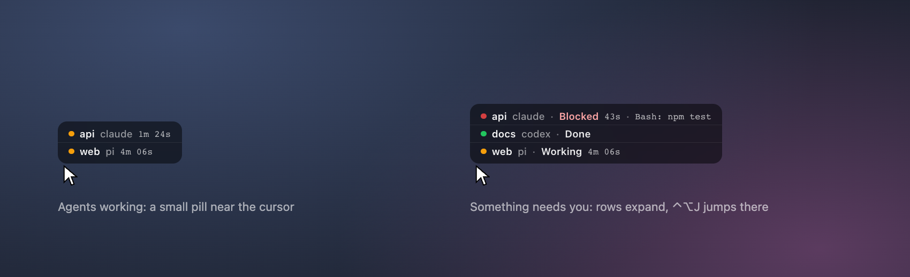

# Agent Cursor

**See which of your coding agents need you, without hunting through terminal panes.**

A small overlay follows your mouse and shows which agent panes are working, blocked or done. One hotkey (**⌃⌥J**) jumps straight to the agent waiting on you. Built as a plugin for [herdr](https://herdr.dev), a terminal workspace manager for AI coding agents.



<sub>Rendered from the real overlay UI with sample data (`docs/make-screenshot.mjs`).</sub>

## What it shows

- **Working:** a single small pill naming the agents. Idle panes stay hidden.
- **Blocked:** expands to rows, showing what the agent is asking (`Bash: npm test`).
- **Done:** rows stay until you move the mouse or focus the pane, then fade after 4s.
- Hidden while herdr's own terminal is in front, since herdr already shows state there.
- **⌃⌥J** jumps to what needs you: blocked (longest waiting) → finished but not visited (newest) → last finished. It focuses the pane and brings the terminal forward; press again to cycle. Nothing to do → "All quiet".
- Same-named panes are told apart by tab (`api/2`); `herdr agent rename` wins.

## Requirements

macOS 12+, [herdr](https://herdr.dev) ≥ 0.8, Node 20+. The overlay ships prebuilt (`native/bin`, universal arm64/x86_64, ad-hoc signed); Xcode CLT only needed to rebuild (`sh native/build.sh`).

## Install

From a clone:

```sh
sh bin/install.sh        # herdr plugin link + start
```

From GitHub:

```sh
herdr plugin install andresaraujo/agent-cursor
```

Starts automatically with the herdr server.

## Use

```sh
herdr plugin action invoke local.agent-cursor.toggle
sh bin/run.sh status     # daemon + current view
sh bin/run.sh targets    # debug: jump order + tracked rows
npm test
```

Log: `~/.local/state/herdr/plugins/local.agent-cursor/daemon.log`

## Actions from Raycast / launchers

URL scheme (registered by `bin/install.sh`):

| URL | Does |
|---|---|
| `agent-cursor://jump` | same as ⌃⌥J |
| `agent-cursor://focus/w6:p4` | focus that pane (ids from `run.sh status`) |
| `agent-cursor://toggle` · `start` · `stop` | overlay on/off |

```sh
open agent-cursor://jump            # any launcher or Raycast quicklink
sh <plugin>/bin/run.sh jump         # same, skips LaunchServices (faster)
```

Only these actions are accepted; anything else is rejected and logged.

## Config

Optional `~/.config/herdr/plugins/config/local.agent-cursor/config.json`:

```json
{ "hotkey": "ctrl+opt+j", "hideWhenFrontmost": true, "terminalBundleId": "com.mitchellh.ghostty" }
```

`hotkey: null` disables it. Terminal defaults to the app that launched herdr. Restart the daemon after editing (toggle twice).

## How it works

- `herdr-plugin.toml` — startup hook, toggle/status actions
- `src/daemon.mjs` — herdr event streams + poll → state → overlay; hotkey jump
- `native/urlhandler.swift` — `AgentCursor.app`, forwards `agent-cursor://` URLs to `run.sh url`
- `native/overlay.swift` — window, cursor follow, cursor-moved, frontmost hide, global hotkey (`src/overlay.mjs` wraps it)
- `src/state.mjs` — pure reducer/view (visibility, done/seen, names)
- `src/prompt.mjs` — blocked-screen → reason heuristic
- `src/ui.mjs` — overlay HTML
- `src/herdr.mjs` — socket client

## License

MIT. The native overlay window is adapted from [Glimpse](https://github.com/HazAT/glimpse) (MIT, © hazat).
